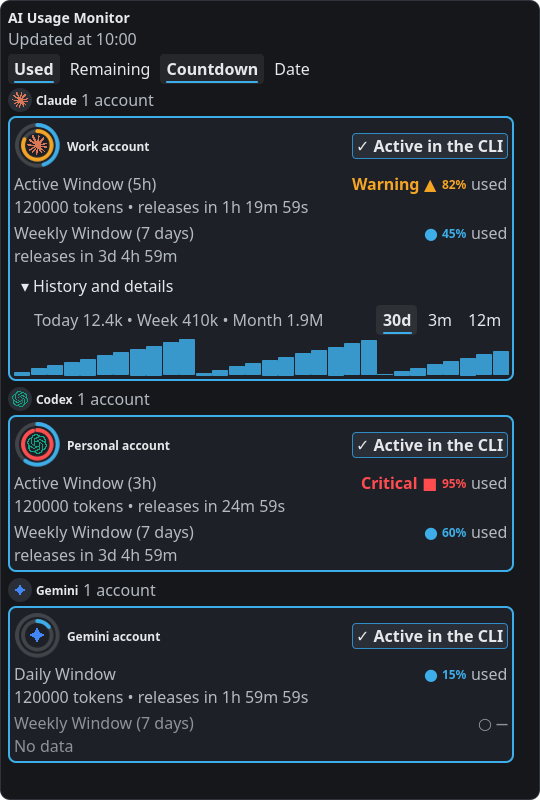

# Plasma AI Usage Widget

**Claude, Codex and Gemini usage limits, right in your KDE Plasma 6 desktop.**

See your quota, reset times and active accounts without opening three separate tools.

[](https://github.com/victorlcs87/plasma-ai-usage-widget/releases/latest)
[](https://pypi.org/project/plasma-ai-usage-collector/)
[](https://kde.org/plasma-desktop/)
[](LICENSE)
[](https://ko-fi.com/victorlcs87)

[Download](https://github.com/victorlcs87/plasma-ai-usage-widget/releases/latest) · [Install](#install) · [Report a bug](https://github.com/victorlcs87/plasma-ai-usage-widget/issues/new?template=bug_report.yml) · [Português brasileiro](README.pt-BR.md)


<p align="center">
  
</p>

*Screenshots render the project's QML components with synthetic demo data. No real account details are shown.*

## Features

- **Three providers in one view:** Claude Code, OpenAI Codex and Gemini / Antigravity usage.
- **Current and weekly quotas:** used or remaining percentages, reset countdowns or dates, with missing data shown explicitly.
- **Multiple accounts:** capture, switch and rename accounts with isolated credential profiles.
- **Early warning:** consumption pace or fixed-threshold alerts, with optional desktop notifications.
- **Your panel, your layout:** rings, percentages, bars, a floating notch and optional session indicators for Claude Code and Codex.
- **Token history:** charts and CSV or JSON export where local usage data is available.
- **English and Brazilian Portuguese**, with support for more translations.
- **Lightweight collector:** no runtime Python package dependencies; optional Waybar JSON output.

## Install

Requirements: **KDE Plasma 6**, **Python 3.10+ with `venv` and `ensurepip`**, and a login for the provider you want to monitor. Quota availability depends on the provider, account and authentication method. An API key alone may not expose subscription limits.

### 1. Install the widget

Download `org.kde.plasma.aiusage.plasmoid` from the [latest release](https://github.com/victorlcs87/plasma-ai-usage-widget/releases/latest). In Plasma, open **Add Widgets → Get New Widgets → Install Widget From Local File**, select the package, then add **AI Usage Monitor** to your panel or desktop. Menu names can vary with the Plasma version and language.

Or install the downloaded file from a terminal:

```bash
kpackagetool6 --type Plasma/Applet --install ./org.kde.plasma.aiusage.plasmoid
```

For an existing installation, replace `--install` with `--upgrade`.

### 2. Install the collector

Open the widget, click **Install collector** and confirm. It installs the matching version from PyPI into its own virtual environment, without `sudo` or changes to system Python. The collector is required to display usage.

Prefer managing it yourself? Use pipx to install the **same version as the widget**. For release `v1.2.1`:

```bash
pipx install plasma-ai-usage-collector==1.2.1
```

### 3. Add your accounts

Sign in through your provider's CLI, then use the widget's account settings to capture the current account. Or capture it from a terminal:

```bash
ai-usage-collector --capture-current claude
ai-usage-collector --capture-current codex
ai-usage-collector --capture-current gemini
ai-usage-collector --refresh
```

Run only the capture commands for providers you use. See [Gemini / Antigravity credential discovery](docs/usage.pt-BR.md#credencial-do-gemini) for its supported local credential sources.

## Read the rings

In the expanded view, the **inner ring** shows the current window and the **outer ring** shows the weekly limit. Window durations depend on provider data; they are not identical for every provider. The compact panel normally shows the current window.

Arcs show **used quota** by default; switch to **Remaining** to see the balance. A white marker indicates elapsed time when the duration is known. Alert colors reflect the configured pace or threshold mode. A dash means there is no reliable reading, rather than zero usage.

## Privacy and connections

The widget and collector run on your machine. There is **no project backend, telemetry or analytics**. Credentials are stored locally; quota checks contact the relevant provider's endpoints.

Optional update checks contact GitHub and the npm registry. Installing the collector contacts PyPI after confirmation. Account capture, switching and renewal use local credentials. Automatic renewal of inactive Gemini accounts is **off by default**; see the [details and limitations](docs/usage.pt-BR.md#renovação-automática-das-contas-inativas).

Provider endpoints can change or rate-limit requests. A missing window, expired session or failed refresh is shown as unavailable or stale data. Quota information is not available for every plan.

## Documentation and development

- [Technical guide in Portuguese](docs/usage.pt-BR.md): configuration, notifications, account renewal, history and translations.
- [Waybar setup](docs/usage.pt-BR.md#waybar): feed Waybar from the collector's local cache with `ai-usage-collector --waybar`.
- [Changelog](CHANGELOG.md) and [design decisions](docs/adr/).

To work on the project:

```bash
git clone https://github.com/victorlcs87/plasma-ai-usage-widget.git
cd plasma-ai-usage-widget
python3 -m venv .venv
.venv/bin/pip install -e . pytest build setuptools wheel
scripts/install-plasmoid.sh
```

Set the collector path in the widget settings to the checkout's `.venv/bin/ai-usage-collector`. Read [CONTRIBUTING.md](CONTRIBUTING.md) for tests, translations and pull requests.

## Help improve the project

[Report a bug](https://github.com/victorlcs87/plasma-ai-usage-widget/issues/new?template=bug_report.yml), [suggest a feature](https://github.com/victorlcs87/plasma-ai-usage-widget/issues/new?template=feature_request.yml), improve a translation or share the project with other Plasma users. Issues in English and Portuguese are welcome. Remove account details and credentials from anything you upload.

## Support the project

If this widget makes your day easier, you can [buy me a coffee on Ko-fi](https://ko-fi.com/victorlcs87). Voluntary support helps me maintain and improve the project. The widget remains free and open source.

## License

[GPL-3.0-or-later](LICENSE). Independent community project, not affiliated with or endorsed by KDE, Anthropic, OpenAI or Google. Provider logos identify their services; see [logo credits](plasmoid/contents/ui/LOGOS.md).
